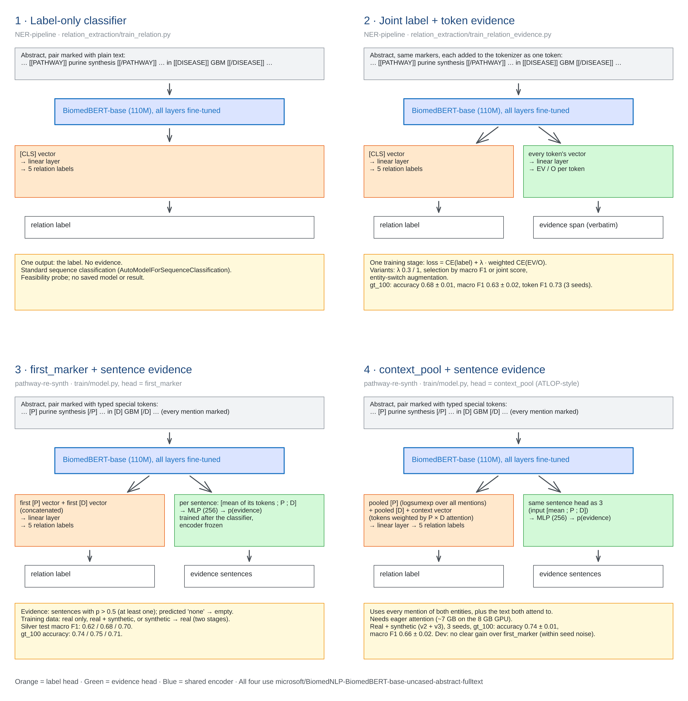
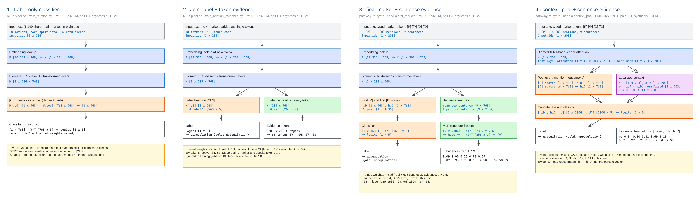
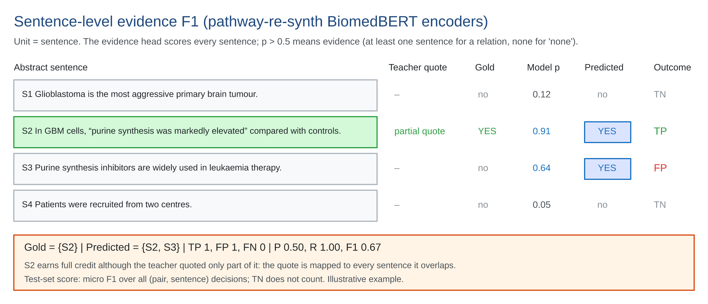
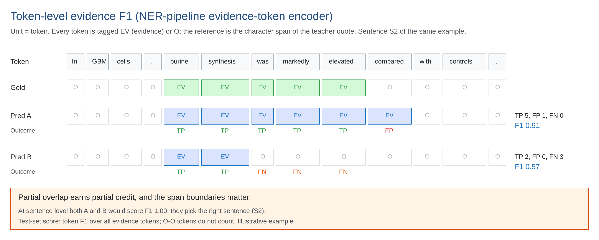

# Model architecture figures

This file collects the architecture figures in this folder. For each figure it explains:

- what the numbers mean;
- what each step does;
- where the code lives;
- which checkpoints belong to that architecture.

All tensor-shape figures trace one real abstract, **PMID 32732914** (glioblastoma, radiation resistance; 1,149 characters, 9 sentences), so the numbers can be compared across figures.
The relation figures use the pair **"GTP synthesis" – "GBM"**:

- in that abstract it has 3 pathway mentions and 6 disease mentions;
- its teacher label is `upregulation`;
- its teacher evidence is sentences S4 and S8.

"Ground truth" in this file means the held-out relation test set (180 pairs, 79 abstracts). Its file is still named `gt_100` in the repositories.

Recurring numbers:

| Number | Meaning |
|---|---|
| 768 | Hidden size of BiomedBERT-base: each token becomes a vector of 768 numbers. |
| 1024 | Hidden size of BioM-ELECTRA-large. |
| 30,522 | Vocabulary of BiomedBERT, i.e. rows of its embedding matrix. |
| 30,526 | 30,522 + 4 added marker tokens (architectures 2–4). |
| 28,895 | Vocabulary of BioM-ELECTRA-large. |
| 12 / 24 | Transformer layers: 12 in base models, 24 in large models. |
| 12 / 16 | Attention heads per layer: 12 in base models, 16 in large models. |
| 5 | Relation labels: upregulation, downregulation, association, no_association_stated, none. |
| 3 | NER tags: O, B-Pathway, I-Pathway. |
| `[1 x L x H]` | Batch of 1 abstract, L tokens, H numbers per token. |

Paths are relative to the NER-pipeline repository root. Paths under `/home/enes/pathway-re-synth` and `/home/enes/artifacts` point outside this repository, to the author's machine: the sibling relation repository and the checkpoint store.

---

## Overview: four relation architectures on BiomedBERT-base

Single-panel versions:

- [relation_arch_1_label_only.png](figures/relation_arch_1_label_only.png)
- [relation_arch_2_joint_token_evidence.png](figures/relation_arch_2_joint_token_evidence.png)
- [relation_arch_3_first_marker.png](figures/relation_arch_3_first_marker.png)
- [relation_arch_4_context_pool.png](figures/relation_arch_4_context_pool.png)

All four use the same encoder, `microsoft/BiomedNLP-BiomedBERT-base-uncased-abstract-fulltext` (110M parameters, all layers fine-tuned). They differ in:

- how the pair is marked in the text;
- which vectors feed the label head;
- whether there is an evidence head, and at what level (token or sentence).

Colours: orange = label head, green = evidence head, blue = shared encoder.

| | 1 Label-only | 2 Joint token evidence | 3 first_marker | 4 context_pool |
|---|---|---|---|---|
| Repository | NER-pipeline | NER-pipeline | pathway-re-synth | pathway-re-synth |
| Markers | plain text | 4 added tokens | typed tokens `[P] [/P] [D] [/D]` | same as 3 |
| Label head input | `[CLS]` | `[CLS]` | first `[P]` + first `[D]` | all `[P]`, all `[D]` pooled + context |
| Evidence | none | per token, trained jointly | per sentence, trained after, encoder frozen | same as 3 |
| Trained weights saved | no | yes | yes | yes |

Comparison status: only 3 vs 4 was compared under the same conditions (same data, same 3 seeds); the difference was within seed noise. The four were never compared under one setup.

---

## Relation tensor shapes (all four side by side)

Single-panel versions:

- [relation_shapes_1_label_only.png](figures/relation_shapes_1_label_only.png)
- [relation_shapes_2_joint_token_evidence.png](figures/relation_shapes_2_joint_token_evidence.png)
- [relation_shapes_3_first_marker.png](figures/relation_shapes_3_first_marker.png)
- [relation_shapes_4_context_pool.png](figures/relation_shapes_4_context_pool.png)

Produced by [shapes.py](scripts/shapes.py) (raw output: [shapes_out.txt](scripts/shapes_out.txt)). Shapes come from running the real tokenizer and models on the example pair. Architectures 2–4 load trained weights; architecture 1 has none, so its shapes come from the base model.

### 1 · Label-only classifier

**Steps**

- Wrap every mention of the pair in plain-text markers: `[[PATHWAY]] … [[/PATHWAY]]`, `[[DISEASE]] … [[/DISEASE]]`.
- Tokenize the marked abstract and run BiomedBERT.
- Take the `[CLS]` vector, pass it through the BERT pooler (dense layer + tanh), then a linear layer gives 5 label scores and softmax picks one.
- Output: label only, no evidence.

**Numbers**

- `input_ids [1 x 284]`: 284 tokens. There are 18 markers (3 pathway + 6 disease mentions × 2 markers). Each plain-text marker splits into 5–6 word pieces, which costs 81 extra tokens compared with architectures 2–4 (284 vs 203).
- `E [30,522 x 768]`: embedding table, one 768-number row per vocabulary entry. Lookup gives `X [1 x 284 x 768]`.
- `H [1 x 284 x 768]`: output of 12 transformer layers, one 768-vector per token.
- `H[:,0] [1 x 768]`: the `[CLS]` vector. `W_pool [768 x 768]` is the pooler. `W [768 x 5]` maps it to `logits [1 x 5]`.

**Implementation**

- Code: `relation_extraction/train_relation.py`
  - `mark()` adds the markers;
  - `AutoModelForSequenceClassification` provides the `[CLS]` + pooler + classifier.
- Trained on `data/processed/relation/silver_2k_full/relations_llm_opus48_same_sentence.jsonl`; tested on `data/processed/gt_100/candidates_v4.jsonl`.

**Checkpoints:** none. It was a feasibility probe: `--save-model` defaults to off, and the default output `models_re/relation_ft` does not exist.

### 2 · Joint label + token evidence

**Steps**

- Use the same markers as 1, but add the 4 marker strings to the tokenizer as single tokens (embedding matrix grows by 4 rows).
- Run BiomedBERT once; two heads read the output.
  - Label head: `[CLS]` → linear layer → 5 labels (no pooler).
  - Evidence head: every token vector → linear layer → EV or O for each token.
- Train both heads together: loss = CE(label) + λ · weighted CE(EV/O). λ = 1.0 in the traced run. EV is rare, so it is weighted about 9× (`ev_weights` 0.558 / 4.838).
- Output: label plus a verbatim evidence span, i.e. the tokens tagged EV.

**Numbers**

- `input_ids [1 x 203]`: each marker is now 1 token.
- `E [30,526 x 768]`: 30,522 + 4 new rows.
- `W_label [768 x 5]` gives `logits [1 x 5]`, predicted `upregulation` (correct).
- `W_ev [768 x 2]` gives `ev_logits [203 x 2]`, one EV/O score pair per token.
- The argmax marks 66 tokens as EV, which cover sentences S4, S7 and S8. The teacher's evidence is S4 and S8.
- Marker and special tokens are ignored in the evidence loss (label -100).
- Figure note, 3 seeds on ground truth: accuracy 0.68 ± 0.01, macro F1 0.63 ± 0.02, evidence token F1 0.73.

**Implementation**

- Code: `relation_extraction/train_relation_evidence.py`. Classes and functions: `TwoHeadModel`, `mark_with_map()`, `MARK_TOKENS`.
- Training data: same silver source as 1 (`silver_2k_full`); the `10kpm` runs use the relabelled 10k-plus-missing labels.

**Checkpoints**

| Path | Contents |
|---|---|
| `models_re/relation_ft_evidence/ev_lam1_selF1_10kpm_s42/` | `model.pt`, used in the figure |
| `…/ev_lam1_selF1_10kpm_s1/`, `…/ev_lam1_selF1_10kpm_s7/` | same configuration, seeds 1 and 7 |
| `/home/enes/artifacts/checkpoints/relation_ft_evidence/ev_lam1_selF1_es5/`, `…/ev_lam1_selF1_rerun/` | earlier runs with `model.pt` |
| `…/ev_lam03_selJoint/`, `…/ev_lam1_selF1/`, `…/ev_lam1_selJoint/` | metrics only, no weights |

Run name key:

- `lam1` / `lam03`: λ = 1.0 / 0.3;
- `selF1` / `selJoint`: checkpoint selected by macro F1 / by a joint label + evidence score;
- `es5`: early-stopping patience 5;
- `s42`: seed.

### 3 · first_marker + sentence evidence

**Steps**

- Wrap every mention in typed special tokens `[P] … [/P]`, `[D] … [/D]`.
- Run BiomedBERT.
- Label head: take the vector of the **first** `[P]` and the **first** `[D]` token, concatenate them, then a linear layer gives 5 labels. This follows Zhou & Chen 2021.
- Evidence head, trained after the classifier with the encoder frozen:
  - for each sentence, average its token vectors;
  - append the pair vector;
  - a small MLP (2304 → 256 → 1) gives p(evidence);
  - sentences with p > 0.5 are evidence (at least one is kept for a relation, none when the label is `none`).

**Numbers**

- `input_ids [1 x 203]`; vocabulary 30,526; 3 `[P]` and 6 `[D]` markers; 9 sentences.
- `h_P [1 x 768]`, `h_D [1 x 768]` give `pair [1 x 1536]` (1536 = 2 × 768).
- `W [1536 x 5]` gives `logits [1 x 5]`, predicted `upregulation` (correct).
- `sentence_features [9 x 2304]`: one row per sentence, 2304 = 768 (sentence mean) + 1536 (pair).
- `W1 [2304 x 256]` → ReLU → `W2 [256 x 1]` gives 9 probabilities: `0.09 0.00 0.25 0.98 0.59 0.07 0.98 0.99 0.63`.
  - Above 0.5: S4, S5, S7, S8, S9.
  - The teacher's evidence is S4 and S8, so for this pair TP 2, FP 3.
- Figure note, silver test macro F1 for real only / real + synthetic / two-stage: 0.62 / 0.68 / 0.70. On ground truth the accuracy is 0.74 / 0.75 / 0.71.

**Implementation**

- Code: `/home/enes/pathway-re-synth/train/model.py`, `RelationModel(head="first_marker")`, `EvidenceHead`, `sentence_features()`.
- Training: `train/train.py --mode {silver_only, mixed, two_stage}` with `--head first_marker`, which is the default.
- Test evaluation: `eval/evaluate.py`.

**Checkpoints.** Stored in `/home/enes/artifacts/checkpoints/relation_synthetic_re/`; `pathway-re-synth/checkpoints/<run>` symlinks there. Each run contains `model.pt`, `evidence_head.pt` and `tokenizer/`.

| Run | Training | Note |
|---|---|---|
| `silver_only/silver` | real data only | slide 13, grey |
| `mixed/mixed` | real + 616 synthetic (batch 1), one stage | **used in the figure**; slide 13, blue |
| `two_stage/synthetic` then `two_stage/silver_after_synthetic` | synthetic first, then real | slide 13, orange; slide 14 encoder |
| `mixed_v2v3`, `two_stage_v2v3` | same, with batch 1 + batch 2 synthetic | |
| `mixed_v2v3_fm_s{13,21,42}_micro` | head comparison, 3 seeds, selected on dev micro F1 | from `train/run_heads.sh` |
| `mixed_v2v3_fm_s13_micro_e25` | same, 25 epochs | |
| `mixed_v2v3_smoke` | smoke test | do not use |

The early runs (`silver_only`, `mixed`, `two_stage`, `*_v2v3`) predate the `--head` option, so their config has no head field. `first_marker` was the only head then.

### 4 · context_pool + sentence evidence

**Steps**

- Use the same typed markers as 3, but run the encoder in eager attention mode so the attention weights are returned.
- **Pool every mention:** logsumexp over all `[P]` marker vectors gives `h_P`, and likewise for `[D]`. This uses every mention, not just the first.
- **Localized context:**
  - average the last-layer attention over the 12 heads;
  - take the attention rows of P and of D;
  - multiply them and normalise, which weights tokens that both entities attend to;
  - the weighted sum of token vectors gives `c`.
- Label head: concatenate `[h_P ; h_D ; c]`, then a linear layer gives 5 labels. This is the ATLOP-style head.
- Evidence head: same as 3. It reads `[sentence mean ; h_P ; h_D]`, not the context vector.

**Numbers**

- `attention [1 x 12 x 203 x 203]`: last layer, 12 heads, every token's attention to every token. The head mean gives `[1 x 203 x 203]`.
- `[P] states [3 x 768]` give `h_P [1 x 768]`; `[D] states [6 x 768]` give `h_D [1 x 768]`.
- `a_P`, `a_D [1 x 203]`: attention rows. `w = a_P · a_D`, normalised, gives `c = w · H [1 x 768]`.
- `[h_P ; h_D ; c] [1 x 2304]` times `W [2304 x 5]` gives `logits [1 x 5]`, predicted `upregulation` (correct).
- Evidence p: `0.04 0.00 0.21 0.69 0.13 0.01 0.77 0.78 0.20`.
  - Above 0.5: S4, S7, S8.
  - For this pair TP 2, FP 1, cleaner than 3.
- Figure note, 3 seeds (real + synthetic v2 + v3) on ground truth: accuracy 0.74 ± 0.01, macro F1 0.66 ± 0.02. On dev there was no clear gain over first_marker (within seed noise). It needs eager attention, which uses about 7 GB on the 8 GB GPU.

**Implementation**

- Code: `/home/enes/pathway-re-synth/train/model.py`: `RelationModel(head="context_pool")`, `pool_entity()`, `localized_context()`.
- Training: `train/train.py --head context_pool` (commit 7cf2451); runner `train/run_heads.sh`.

**Checkpoints** (`/home/enes/artifacts/checkpoints/relation_synthetic_re/`):

| Run | Note |
|---|---|
| `mixed_v2v3_ctx_s13_micro/mixed` | **used in the figure** |
| `mixed_v2v3_ctx_s21_micro/mixed`, `mixed_v2v3_ctx_s42_micro/mixed` | seeds 21 and 42 |

All three are mixed mode with v2 + v3 synthetic data, selected on dev micro F1.

---

## Pathway NER tensor shapes

Produced by [ner_shapes.py](scripts/ner_shapes.py) (raw output: [ner_shapes_out.txt](scripts/ner_shapes_out.txt)). It uses the same abstract, PMID 32732914, which is part of the 125-abstract NER ground truth.

**Steps**

- Tokenize the plain abstract. NER needs no markers.
- Embeddings: word + position + token type, summed.
- 24 transformer layers, all fine-tuned.
- Token classifier: a linear layer gives 3 scores per token (O, B-Pathway, I-Pathway), followed by softmax. Only the first word piece of each word is used.
- Decode: each B followed by its I tokens becomes one character span.

**Numbers**

- `input_ids [1 x 185]`: 185 = 174 words (first piece) + 9 continuation pieces + `[CLS]` + `[SEP]`.
- Embeddings:
  - word `[28,895 x 1024]`;
  - position `[512 x 1024]` (maximum 512 tokens);
  - token type `[2 x 1024]`;
  - their sum gives `X [1 x 185 x 1024]`.
- Each layer:
  - attention `A [1 x 16 x 185 x 185]` (16 heads);
  - feed-forward 1024 → 4096 → 1024;
  - output `H [1 x 185 x 1024]`.
- Classifier `W [1024 x 3]` gives `logits [1 x 185 x 3]`. It is the only new layer: 3 × 1024 + 3 = 3,075 parameters.
- Example window (S6): "pyrimidine metabolism" B 1.00 / I 1.00; "purine" B 0.64 vs O 0.36 (the least confident decision); "salvage" I 0.84.
- Result: 6 spans: GTP synthesis × 3, pyrimidine metabolism, purine salvage, purine synthesis. These are the same 6 as the ground truth, so TP 6, FP 0, FN 0 with exact match.
- Total parameters: 332.4M.
- Training:
  - final corpus of 10,900 abstracts (8,725 train / 1,087 val / 1,088 test);
  - lr 3e-5, seed 42;
  - loss: cross-entropy with class weights O 0.5 / B 1.5 / I 1.0;
  - continuation pieces and special tokens are ignored (-100).

**Implementation**

- Code: `train.py` (`ElectraForTokenClassification` through `AutoModelForTokenClassification`). Encoder registry: `encoders.py`. Preprocessing: `preprocessing/*.py`.
- Ground truth: `doccano/golden_dataset/gt_125/gt_125.jsonl`.

**Checkpoints**

| Path | Contents |
|---|---|
| `/home/enes/artifacts/checkpoints/ner_pathway-10k-missing/pathway-10k-missing/biom-electra-large/lr3e-05/seed42` | final model, used in the figure (F1 0.830 on ground truth) |
| `…/pathway-10k-missing/bioelectra-base/` | BioELECTRA-base on the final corpus |
| `/home/enes/artifacts/checkpoints/ner_pathway-10k-missing-shuffle/` | re-split (shuffle) runs, with `gt_100_scores.json` and `gt_125_scores.json` |

The first-stage comparison runs (5 encoders × 3 seeds) are indexed in `runs/summary.jsonl`.

---

## Evidence metrics: sentence level vs token level

These two figures are not architectures; they explain why the evidence F1 of architecture 2 cannot be compared with that of architectures 3–4. Both use an **illustrative** example, not real model output.

### Sentence level (architectures 3 and 4)

- Unit = sentence. Every sentence is scored, and p > 0.5 means evidence.
- A sentence is gold if the teacher quote overlaps it. A partial quote still makes the whole sentence gold (S2).
- Example: gold {S2}, predicted {S2, S3}, so TP 1, FP 1, FN 0, which gives P 0.50, R 1.00, F1 0.67.
- Test score: micro F1 over all (pair, sentence) decisions; TN does not count.
- This is the "Evidence F1" on slides 13–14 (0.59–0.62).

### Token level (architecture 2)

- Unit = token. Every token is EV or O; the reference is the character span of the teacher quote.
- Pred A over-extends by one token ("compared"): TP 5, FP 1, so F1 0.91.
- Pred B stops early after "purine synthesis": TP 2, FN 3, so F1 0.57.
- At sentence level both would score 1.00, because both pick S2.
- So token F1 is stricter about boundaries, and partial overlap earns partial credit.
- The 0.73 token F1 of architecture 2 is therefore not comparable with the 0.59–0.62 sentence F1 of architectures 3–4.
