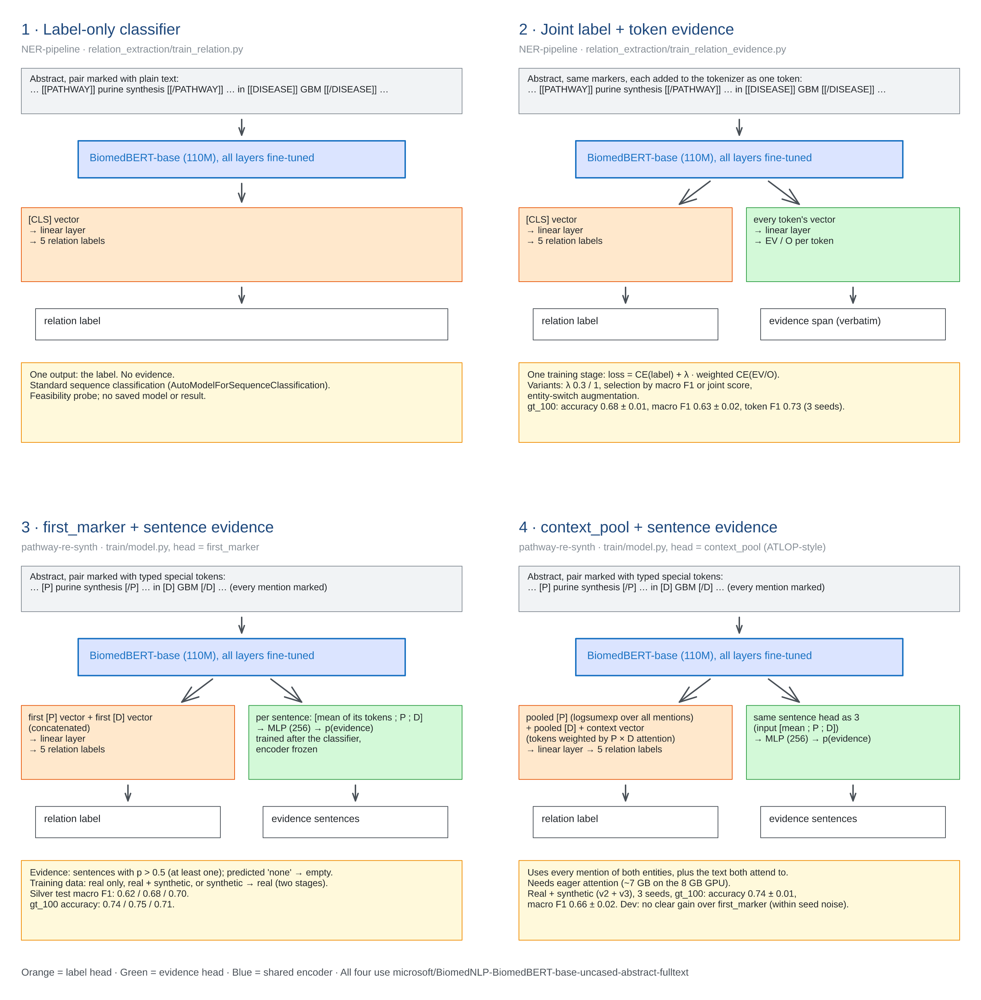
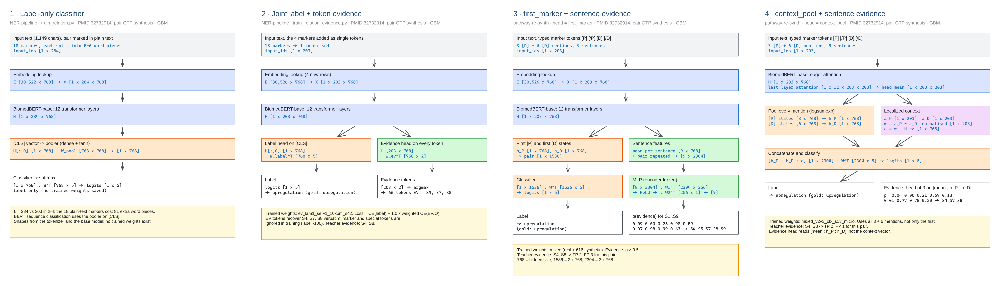
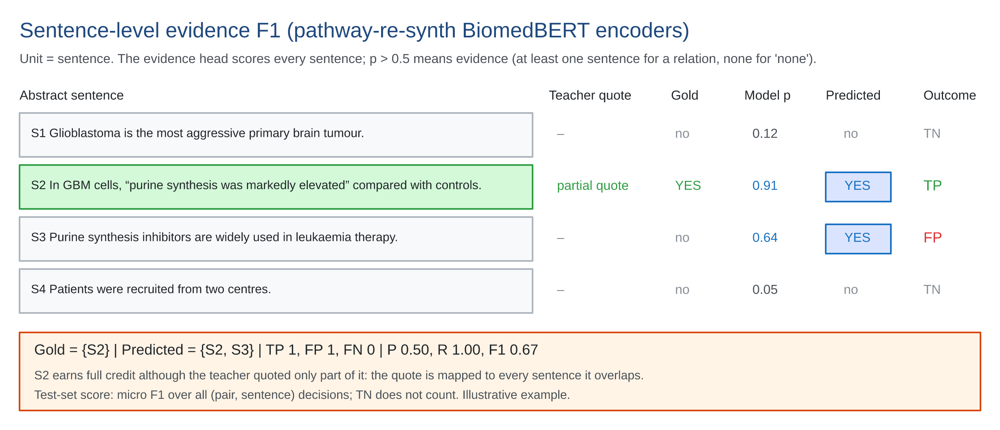
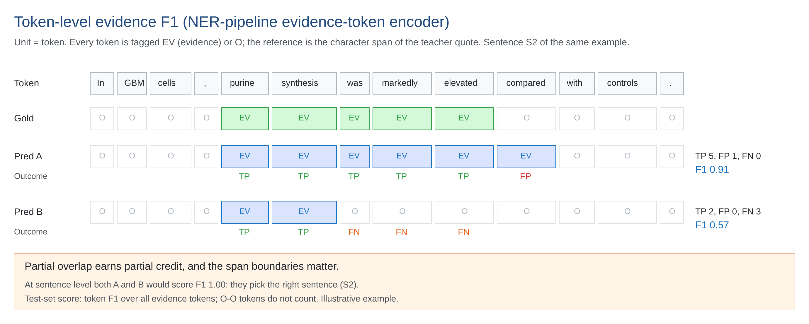

# Model mimarisi figürleri

Bu dosya, klasördeki mimari figürlerini toplar. Her figür için şunları açıklar:

- sayıların ne anlama geldiği;
- her adımda ne yapıldığı;
- kodun nerede olduğu;
- o mimariye hangi checkpoint'lerin ait olduğu.

İngilizce sürüm: [architectures.md](architectures.md).

Tensör boyutlarını gösteren tüm figürler tek bir gerçek abstract üzerinden çizildi: **PMID 32732914** (glioblastoma, radyasyon direnci; 1.149 karakter, 9 cümle). Bu sayede sayılar figürler arasında karşılaştırılabilir.

Relation figürleri **"GTP synthesis" – "GBM"** çiftini kullanır:

- bu abstract'ta 3 pathway mention'ı ve 6 disease mention'ı var;
- teacher etiketi `upregulation`;
- teacher evidence'ı S4 ve S8 cümleleri.

Bu dosyada "ground truth", elde tutulan relation test setini ifade eder (180 çift, 79 abstract). Dosya adı repolarda hâlâ `gt_100`.

Tekrar eden sayılar:

| Sayı | Anlamı |
|---|---|
| 768 | BiomedBERT-base'in hidden boyutu: her token 768 sayılık bir vektöre dönüşür. |
| 1024 | BioM-ELECTRA-large'ın hidden boyutu. |
| 30.522 | BiomedBERT'in sözlüğü, yani embedding matrisinin satır sayısı. |
| 30.526 | 30.522 + 4 eklenen marker token'ı (mimari 2–4). |
| 28.895 | BioM-ELECTRA-large'ın sözlüğü. |
| 12 / 24 | Transformer katman sayısı: base modellerde 12, large modellerde 24. |
| 12 / 16 | Katman başına attention head sayısı: base modellerde 12, large modellerde 16. |
| 5 | Relation etiketleri: upregulation, downregulation, association, no_association_stated, none. |
| 3 | NER tag'leri: O, B-Pathway, I-Pathway. |
| `[1 x L x H]` | 1 abstract'lık batch, L token, token başına H sayı. |

Yollar NER-pipeline reposunun köküne göredir. `/home/enes/pathway-re-synth` ve `/home/enes/artifacts` altındaki yollar bu reponun dışındadır ve yazarın makinesini gösterir: kardeş relation reposu ve checkpoint deposu.

---

## Genel bakış: BiomedBERT-base üzerinde dört relation mimarisi

Tek panelli sürümler:

- [relation_arch_1_label_only.png](figures/relation_arch_1_label_only.png)
- [relation_arch_2_joint_token_evidence.png](figures/relation_arch_2_joint_token_evidence.png)
- [relation_arch_3_first_marker.png](figures/relation_arch_3_first_marker.png)
- [relation_arch_4_context_pool.png](figures/relation_arch_4_context_pool.png)

Dördü de aynı encoder'ı kullanır: `microsoft/BiomedNLP-BiomedBERT-base-uncased-abstract-fulltext` (110M parametre, tüm katmanlar fine-tune). Farkları şunlardır:

- çiftin metinde nasıl işaretlendiği;
- label head'e hangi vektörlerin girdiği;
- evidence head olup olmadığı ve hangi düzeyde olduğu (token ya da cümle).

Renkler: turuncu = label head, yeşil = evidence head, mavi = ortak encoder.

| | 1 Label-only | 2 Joint token evidence | 3 first_marker | 4 context_pool |
|---|---|---|---|---|
| Repo | NER-pipeline | NER-pipeline | pathway-re-synth | pathway-re-synth |
| Marker | düz metin | tokenizer'a eklenen 4 token | tipli token'lar `[P] [/P] [D] [/D]` | 3 ile aynı |
| Label head girdisi | `[CLS]` | `[CLS]` | ilk `[P]` + ilk `[D]` | tüm `[P]` ve tüm `[D]` havuzlanmış + context |
| Evidence | yok | token başına, label ile birlikte eğitilir | cümle başına, sonradan eğitilir, encoder dondurulur | 3 ile aynı |
| Ağırlık kaydedildi mi | hayır | evet | evet | evet |

Karşılaştırma durumu: aynı koşullarda (aynı veri, aynı 3 seed) yalnızca 3 ile 4 karşılaştırıldı ve fark seed gürültüsü içinde kaldı. Dördü hiçbir zaman tek bir düzende karşılaştırılmadı.

---

## Relation tensör boyutları (dördü yan yana)

Tek panelli sürümler:

- [relation_shapes_1_label_only.png](figures/relation_shapes_1_label_only.png)
- [relation_shapes_2_joint_token_evidence.png](figures/relation_shapes_2_joint_token_evidence.png)
- [relation_shapes_3_first_marker.png](figures/relation_shapes_3_first_marker.png)
- [relation_shapes_4_context_pool.png](figures/relation_shapes_4_context_pool.png)

Figürleri [shapes.py](scripts/shapes.py) üretti (ham çıktı: [shapes_out.txt](scripts/shapes_out.txt)). Boyutlar, gerçek tokenizer ve modeller örnek çift üzerinde çalıştırılarak alındı. Mimari 2–4 eğitilmiş ağırlıkları yükler. Mimari 1'in kaydedilmiş ağırlığı olmadığı için boyutları base modelden alındı.

### 1 · Yalnızca label sınıflandırıcı

**Adımlar**

- Çiftin her mention'ı düz metin marker'larla sarılır: `[[PATHWAY]] … [[/PATHWAY]]`, `[[DISEASE]] … [[/DISEASE]]`.
- İşaretlenmiş abstract tokenize edilir ve BiomedBERT'ten geçirilir.
- `[CLS]` vektörü BERT pooler'dan (dense katman + tanh) geçer. Ardından bir linear katman 5 etiket skoru üretir ve softmax birini seçer.
- Çıktı: yalnızca etiket, evidence yok.

**Sayılar**

- `input_ids [1 x 284]`: 284 token.
  - 18 marker var: 3 pathway + 6 disease mention'ı, her biri için 2 marker.
  - Düz metin marker'ların her biri 5–6 word piece'e bölünür.
  - Bu yüzden mimari 2–4'e göre 81 token fazla (284'e karşı 203).
- `E [30.522 x 768]`: embedding tablosu; her sözlük girdisi için 768 sayılık bir satır. Lookup sonucu `X [1 x 284 x 768]`.
- `H [1 x 284 x 768]`: 12 transformer katmanının çıktısı; her token için bir 768-vektör.
- `H[:,0] [1 x 768]`: `[CLS]` vektörü.
  - `W_pool [768 x 768]`: pooler.
  - `W [768 x 5]`: vektörü `logits [1 x 5]`'e çevirir.

**Implementasyon**

- Kod: `relation_extraction/train_relation.py`
  - `mark()` marker'ları ekler.
  - `AutoModelForSequenceClassification`, `[CLS]` + pooler + classifier zincirini sağlar.
- Eğitim verisi: `data/processed/relation/silver_2k_full/relations_llm_opus48_same_sentence.jsonl`.
- Test: `data/processed/gt_100/candidates_v4.jsonl`.

**Checkpoint:** yok. Feasibility probe'du: `--save-model` varsayılan olarak kapalı ve varsayılan çıktı klasörü `models_re/relation_ft` mevcut değil.

### 2 · Ortak label + token evidence

**Adımlar**

- Marker'lar 1'dekiyle aynı, ancak 4 marker metni tokenizer'a tek token olarak eklenir; embedding matrisi 4 satır büyür.
- BiomedBERT bir kez çalışır ve çıktısını iki head okur:
  - **Label head:** `[CLS]` → linear → 5 etiket (pooler yok).
  - **Evidence head:** her token vektörü → linear → her token için EV ya da O.
- İki head birlikte eğitilir:
  - loss = CE(label) + λ · ağırlıklı CE(EV/O); çizilen run'da λ = 1,0.
  - EV nadir bir sınıf olduğu için yaklaşık 9 kat ağırlık alır (`ev_weights` 0,558 / 4,838).
- Çıktı: etiket ve birebir alıntı evidence span'i, yani EV olarak etiketlenen token'lar.

**Sayılar**

- `input_ids [1 x 203]`: her marker artık 1 token.
- `E [30.526 x 768]`: 30.522 + 4 yeni satır.
- `W_label [768 x 5]` → `logits [1 x 5]`. Tahmin `upregulation`, doğru.
- `W_ev [768 x 2]` → `ev_logits [203 x 2]`: her token için bir EV/O skor çifti.
- Argmax 66 token'ı EV olarak işaretler. Bu token'lar S4, S7 ve S8 cümlelerini kapsar; teacher evidence'ı ise S4 ve S8.
- Marker ve özel token'lar evidence loss'unda yok sayılır (label -100).
- Figürdeki not, ground truth üzerinde 3 seed ortalaması:
  - accuracy 0,68 ± 0,01;
  - macro F1 0,63 ± 0,02;
  - evidence token F1 0,73.

**Implementasyon**

- Kod: `relation_extraction/train_relation_evidence.py`
  - `TwoHeadModel`, `mark_with_map()`, `MARK_TOKENS`.
- Eğitim verisi 1 ile aynı silver kaynak (`silver_2k_full`). `10kpm` run'ları yeniden etiketlenmiş 10k-plus-missing etiketlerini kullanır.

**Checkpoint'ler**

| Yol | İçerik |
|---|---|
| `models_re/relation_ft_evidence/ev_lam1_selF1_10kpm_s42/` | `model.pt`; figürde kullanılan |
| `…/ev_lam1_selF1_10kpm_s1/`, `…/ev_lam1_selF1_10kpm_s7/` | aynı ayar; seed 1 ve 7 |
| `/home/enes/artifacts/checkpoints/relation_ft_evidence/ev_lam1_selF1_es5/`, `…/ev_lam1_selF1_rerun/` | `model.pt` içeren daha eski run'lar |
| `…/ev_lam03_selJoint/`, `…/ev_lam1_selF1/`, `…/ev_lam1_selJoint/` | yalnızca metrikler, ağırlık yok |

Run adı anahtarı:

- `lam1` / `lam03`: λ = 1,0 / 0,3.
- `selF1` / `selJoint`: checkpoint macro F1'e / label + evidence ortak skoruna göre seçildi.
- `es5`: early stopping patience 5.
- `s42`: seed.

### 3 · first_marker + cümle evidence

**Adımlar**

- Her mention tipli özel token'larla sarılır: `[P] … [/P]`, `[D] … [/D]`.
- BiomedBERT çalışır.
- **Label head:** **ilk** `[P]` ve **ilk** `[D]` token'ının vektörleri uç uca eklenir, ardından linear katman 5 etiket verir (Zhou & Chen 2021).
- **Evidence head:** classifier'dan sonra, encoder dondurularak eğitilir.
  - Her cümle için token vektörlerinin ortalaması alınır.
  - Bu ortalamaya çift vektörü eklenir.
  - Küçük bir MLP (2304 → 256 → 1) p(evidence) verir.
  - p > 0,5 olan cümleler evidence sayılır. Bir relation için en az bir cümle tutulur; etiket `none` ise hiç cümle tutulmaz.

**Sayılar**

- `input_ids [1 x 203]`, sözlük 30.526, 3 `[P]` ve 6 `[D]` marker'ı, 9 cümle.
- `h_P [1 x 768]` ve `h_D [1 x 768]` → `pair [1 x 1536]` (1536 = 2 × 768).
- `W [1536 x 5]` → `logits [1 x 5]`. Tahmin `upregulation`, doğru.
- `sentence_features [9 x 2304]`: cümle başına bir satır. 2304 = 768 (cümle ortalaması) + 1536 (çift).
- `W1 [2304 x 256]` → ReLU → `W2 [256 x 1]`, 9 olasılık verir: `0,09 0,00 0,25 0,98 0,59 0,07 0,98 0,99 0,63`.
  - 0,5'in üstündekiler S4, S5, S7, S8 ve S9.
  - Teacher evidence'ı S4 ve S8 olduğu için bu çiftte TP 2, FP 3.
- Figürdeki not:
  - silver test macro F1, sırasıyla yalnız gerçek veri / gerçek + sentetik / iki aşamalı: 0,62 / 0,68 / 0,70;
  - aynı sırayla ground truth accuracy: 0,74 / 0,75 / 0,71.

**Implementasyon**

- Kod: `/home/enes/pathway-re-synth/train/model.py`
  - `RelationModel(head="first_marker")`, `EvidenceHead`, `sentence_features()`.
- Eğitim: `train/train.py --mode {silver_only, mixed, two_stage}`, `--head first_marker` (varsayılan).
- Test değerlendirmesi: `eval/evaluate.py`.

**Checkpoint'ler**

Konum: `/home/enes/artifacts/checkpoints/relation_synthetic_re/`. `pathway-re-synth/checkpoints/<run>` buraya symlink verir. Her run'da `model.pt`, `evidence_head.pt` ve `tokenizer/` bulunur.

| Run | Eğitim | Not |
|---|---|---|
| `silver_only/silver` | yalnız gerçek veri | slayt 13, gri |
| `mixed/mixed` | gerçek + 616 sentetik (batch 1), tek aşama | **figürde kullanılan**; slayt 13, mavi |
| `two_stage/synthetic` → `two_stage/silver_after_synthetic` | önce sentetik, sonra gerçek | slayt 13 turuncu; slayt 14'teki encoder |
| `mixed_v2v3`, `two_stage_v2v3` | aynısı, batch 1 + batch 2 sentetik | |
| `mixed_v2v3_fm_s{13,21,42}_micro` | head karşılaştırması: 3 seed, dev micro F1 ile seçim | `train/run_heads.sh` |
| `mixed_v2v3_fm_s13_micro_e25` | aynısı, 25 epoch | |
| `mixed_v2v3_smoke` | smoke test | kullanma |

Erken run'lar (`silver_only`, `mixed`, `two_stage`, `*_v2v3`) `--head` seçeneğinden önce yapıldı, bu yüzden config'lerinde head alanı yok. O dönemde tek head `first_marker`'dı.

### 4 · context_pool + cümle evidence

**Adımlar**

- Marker'lar 3 ile aynı. Encoder eager attention modunda çalışır, böylece attention ağırlıkları da döner.
- **Her mention'ı havuzla:** tüm `[P]` marker vektörleri üzerinde logsumexp alınır ve `h_P` elde edilir; `[D]` için de aynısı yapılır. Böylece yalnızca ilk mention değil, hepsi kullanılır.
- **Yerel bağlam (localized context):**
  - son katmanın attention'ı 12 head üzerinden ortalanır;
  - P'nin ve D'nin attention satırları alınır;
  - bu iki satır çarpılıp normalize edilir; böylece iki varlığın da dikkat ettiği token'lar ağırlık kazanır;
  - token vektörlerinin bu ağırlıklarla toplamı `c` vektörünü verir.
- **Label head:** `[h_P ; h_D ; c]` uç uca eklenir, ardından linear katman 5 etiket verir (ATLOP tarzı).
- **Evidence head:** 3 ile aynı; `[cümle ortalaması ; h_P ; h_D]` okur, context vektörünü okumaz.

**Sayılar**

- `attention [1 x 12 x 203 x 203]`: son katman, 12 head, her token'ın her token'a dikkati. Head ortalaması `[1 x 203 x 203]`.
- `[P] durumları [3 x 768]` → `h_P [1 x 768]`. `[D] durumları [6 x 768]` → `h_D [1 x 768]`.
- `a_P`, `a_D [1 x 203]`: attention satırları. `w = a_P · a_D` normalize edilir, `c = w · H [1 x 768]`.
- `[h_P ; h_D ; c] [1 x 2304]` × `W [2304 x 5]` → `logits [1 x 5]`. Tahmin `upregulation`, doğru.
- Evidence p: `0,04 0,00 0,21 0,69 0,13 0,01 0,77 0,78 0,20`.
  - 0,5'in üstündekiler S4, S7 ve S8.
  - Bu çiftte TP 2, FP 1; mimari 3'ten daha temiz.
- Figürdeki not, ground truth üzerinde 3 seed (gerçek + sentetik v2 + v3):
  - accuracy 0,74 ± 0,01;
  - macro F1 0,66 ± 0,02;
  - dev setinde first_marker'a göre net bir kazanç yok, fark seed gürültüsü içinde;
  - eager attention gerektirir, 8 GB GPU'da yaklaşık 7 GB kullanır.

**Implementasyon**

- Kod: `/home/enes/pathway-re-synth/train/model.py`
  - `RelationModel(head="context_pool")`, `pool_entity()`, `localized_context()`.
- Eğitim: `train/train.py --head context_pool` (commit 7cf2451). Çalıştırıcı: `train/run_heads.sh`.

**Checkpoint'ler** (`/home/enes/artifacts/checkpoints/relation_synthetic_re/`):

| Run | Not |
|---|---|
| `mixed_v2v3_ctx_s13_micro/mixed` | **figürde kullanılan** |
| `mixed_v2v3_ctx_s21_micro/mixed`, `mixed_v2v3_ctx_s42_micro/mixed` | seed 21 ve 42 |

Üçü de mixed mod; v2 + v3 sentetik veriyle eğitildi ve dev micro F1 ile seçildi.

---

## Pathway NER tensör boyutları

Figürü [ner_shapes.py](scripts/ner_shapes.py) üretti (ham çıktı: [ner_shapes_out.txt](scripts/ner_shapes_out.txt)). Aynı abstract kullanıldı: PMID 32732914, 125 abstract'lık NER ground truth'unun içinde.

**Adımlar**

- Düz abstract tokenize edilir; NER marker kullanmaz.
- Embedding'ler toplanır: word + position + token type.
- 24 transformer katmanından geçer; tüm katmanlar fine-tune edilmiştir.
- **Token classifier:** linear katman her token için 3 skor verir (O, B-Pathway, I-Pathway), ardından softmax uygulanır. Her kelimenin yalnızca ilk word piece'i kullanılır.
- **Decode:** her B ve onu izleyen I'lar tek bir karakter span'i olur.

**Sayılar**

- `input_ids [1 x 185]`: 185 = 174 kelime (ilk parça) + 9 devam parçası + `[CLS]` + `[SEP]`.
- Embedding'ler:
  - word `[28.895 x 1024]`;
  - position `[512 x 1024]` (en fazla 512 token);
  - token type `[2 x 1024]`;
  - toplamları `X [1 x 185 x 1024]`.
- Her katmanda:
  - attention `A [1 x 16 x 185 x 185]` (16 head);
  - feed-forward 1024 → 4096 → 1024;
  - çıktı `H [1 x 185 x 1024]`.
- Classifier `W [1024 x 3]` → `logits [1 x 185 x 3]`. Tek yeni katman bu: 3 × 1024 + 3 = 3.075 parametre.
- Örnek pencere, S6 cümlesi:
  - "pyrimidine metabolism": B 1,00 / I 1,00;
  - "purine": B 0,64'e karşı O 0,36, en kararsız karar;
  - "salvage": I 0,84.
- Sonuç 6 span: GTP synthesis × 3, pyrimidine metabolism, purine salvage, purine synthesis. Ground truth'taki 6 span'in aynısı; exact match ile TP 6, FP 0, FN 0.
- Toplam 332,4M parametre.
- Eğitim:
  - nihai korpus, 10.900 abstract (8.725 train / 1.087 val / 1.088 test);
  - lr 3e-5, seed 42;
  - loss: sınıf ağırlıklı cross-entropy (O 0,5 / B 1,5 / I 1,0);
  - devam parçaları ve özel token'lar yok sayılır (-100).

**Implementasyon**

- Kod: `train.py` (`AutoModelForTokenClassification` üzerinden `ElectraForTokenClassification`).
- Encoder kaydı: `encoders.py`. Ön işleme: `preprocessing/*.py`.
- Ground truth: `doccano/golden_dataset/gt_125/gt_125.jsonl`.

**Checkpoint'ler**

| Yol | İçerik |
|---|---|
| `/home/enes/artifacts/checkpoints/ner_pathway-10k-missing/pathway-10k-missing/biom-electra-large/lr3e-05/seed42` | nihai model; figürde kullanılan (ground truth F1 0,830) |
| `…/pathway-10k-missing/bioelectra-base/` | nihai korpusla eğitilen BioELECTRA-base |
| `/home/enes/artifacts/checkpoints/ner_pathway-10k-missing-shuffle/` | yeniden bölünmüş (shuffle) run'lar; `gt_100_scores.json` ve `gt_125_scores.json` içerir |

İlk aşama karşılaştırma run'larının (5 encoder × 3 seed) indeksi: `runs/summary.jsonl`.

---

## Evidence metrikleri: cümle düzeyi ve token düzeyi

Bu iki figür bir mimari göstermez. Mimari 2'nin evidence F1'inin mimari 3–4'ünkiyle neden karşılaştırılamayacağını açıklar. İkisi de gerçek model çıktısı değil, **temsilî** bir örnek kullanır.

### Cümle düzeyi (mimari 3 ve 4)

- Birim cümledir. Her cümle skorlanır; p > 0,5 evidence demektir.
- Teacher alıntısıyla örtüşen cümle gold sayılır. Alıntı cümlenin yalnızca bir kısmını kapsasa da cümlenin tamamı gold olur (S2).
- Örnek: gold {S2}, tahmin {S2, S3}. TP 1, FP 1, FN 0; P 0,50, R 1,00, F1 0,67.
- Test skoru, tüm (çift, cümle) kararları üzerinden micro F1'dir; TN sayılmaz.
- Slayt 13–14'teki "Evidence F1" (0,59–0,62) bu metriktir.

### Token düzeyi (mimari 2)

- Birim token'dır. Her token EV ya da O olarak etiketlenir; referans, teacher alıntısının karakter span'idir.
- **Tahmin A** bir token fazla alır ("compared"): TP 5, FP 1, F1 0,91.
- **Tahmin B** erken durur, yalnızca "purine synthesis"i alır: TP 2, FN 3, F1 0,57.
- Cümle düzeyinde ikisi de 1,00 alırdı, çünkü ikisi de S2'yi seçiyor.
- Token F1 sınırlara karşı daha katıdır; kısmi örtüşme kısmi puan alır.
- Bu nedenle mimari 2'nin 0,73 token F1'i, mimari 3–4'ün 0,59–0,62 cümle F1'i ile karşılaştırılamaz.
