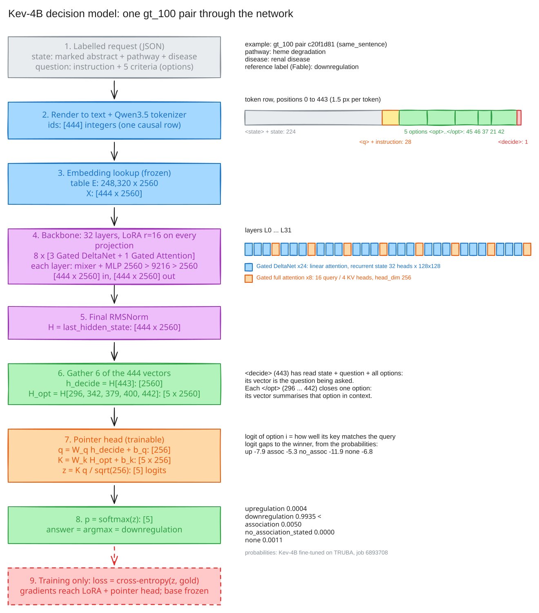

# How Kev decides a relation: one gt_100 pair through the network

Kev is the decision model we fine-tune for pathway–disease relation
classification. It does not generate text. It reads the abstract and the
question as one token sequence, then *points* at one of the answer options.

This file follows one real ground-truth pair through every step. For each step
it gives:

- what happens;
- the shape of every tensor that is passed on, and what it means;
- where the code is.



The editable source of the figure is
[kev_architecture.excalidraw](kev_architecture.excalidraw) (open it at
excalidraw.com).

The example pair is **"heme degradation" – "renal disease"** from the relation
test set (gt_100 candidate `c20f1d81558adc64`, stratum `same_sentence`):

- the abstract has 1 pathway mention and 1 disease mention, in the same
  sentence;
- the reference label (Fable teacher) is `downregulation`;
- the abstract says that *increasing* heme oxygenase activity, which drives
  heme degradation, protects in renal disease. Under the labelling rule for
  interventions, "activating the pathway helps" means `downregulation`.

Recurring numbers:

| Number | Meaning |
|---|---|
| 444 | Length of this example's token row: state + question + 5 options + `<decide>`. |
| 2560 | Hidden size of Qwen3.5-4B: every token becomes a vector of 2560 numbers. |
| 248,320 | Vocabulary size, i.e. the number of rows of the embedding table. |
| 32 | Decoder layers: 24 Gated DeltaNet + 8 Gated full attention. |
| 9216 | Inner width of every MLP. |
| 256 | Width of the pointer head's matching space (`--head_dim`). |
| 16 | LoRA rank on every projection. |
| 5 | Relation labels: upregulation, downregulation, association, no_association_stated, none. |
| `[a x b]` | a rows of b numbers each. One record is processed at a time, so there is no batch axis. |

---

## Where the numbers come from

- **Layer sizes:** `config.json` and the safetensors headers of
  `Qwen/Qwen3.5-4B-Base@1001bb4d`. Exact.
- **Model code:** Kev at commit `2074cc44` (`kev/model.py`, `kev/api.py`,
  `kev/data.py`, `kev/train.py`). Exact.
- **Token counts and positions:** the model's own tokenizer at the same
  revision, applied with Kev's encoding rules to the record that
  `build_kev_data.py --gt100` writes.
  - Computed locally with `tokenizers` 0.22.2; Kev runs 0.23.2 through
    transformers.
  - Both read the same `tokenizer.json`, so the counts should match, but they
    were not checked inside Kev itself.
- **Probabilities:** `gt_100_predictions.json` of the TRUBA run
  `kev-4b_silver_6893708` (Kev-4B, 1 epoch on the old `silver_2k_full`
  split).
  - For illustration only: one run on the old data, not a result to cite.
- **Values of intermediate vectors:** not measured; only their shapes are
  given.

---

## 1 · Labelled request

**What happens**

- `build_kev_data.py` writes one JSON record per pair:
  - `state`: the abstract with every mention of the pair wrapped in
    `[[PATHWAY]] … [[/PATHWAY]]` and `[[DISEASE]] … [[/DISEASE]]`, plus the
    pathway and disease names;
  - one `choice` question: the instruction and five criteria, one per label;
  - the label.
- Kev's `api.to_record` turns this into plain text:
  - the state is flattened with the field names kept as labels:
    `abstract: …`, `pathway: heme degradation`, `disease: renal disease`;
  - each criterion becomes one option string `"<name>: <description>"`;
  - the label is replaced by its index (1, `downregulation`).

**Numbers**

- 1 state, 1 question, 5 options.

**Implementation**

- `relation_extraction/decision_models/build_kev_data.py`: `request()`,
  `gt100_requests()`, `CRITERIA`, `INSTRUCTIONS`.
- Kev: `kev/api.py` `render()`, `option_text()`, `to_record()`.

## 2 · Tokens: one row of 444 ids

**What happens**

- `kev.model.encode` packs the record into one token row:
  - `<state>` + state text;
  - `<q>` + instruction;
  - for every option: `<opt>` + option text + `</opt>`;
  - `<decide>` at the very end.
- The five delimiters reuse rarely used Qwen tokens, so no embedding rows are
  added:

  | Delimiter | Qwen token | id |
  |---|---|---|
  | `<state>` | `<\|fim_prefix\|>` | 248060 |
  | `<q>` | `<\|fim_middle\|>` | 248061 |
  | `<opt>` | `<\|box_start\|>` | 248049 |
  | `</opt>` | `<\|box_end\|>` | 248050 |
  | `<decide>` | `<\|fim_suffix\|>` | 248062 |

- Text supplied by the user can never produce a delimiter: any `<|name|>`
  in it is rewritten to `<¦name¦>` before tokenizing.
- **One row per question.** Qwen3.5 is a hybrid model.
  - Its recurrent DeltaNet layers cannot apply the block mask that would let
    several questions share one packed sequence.
  - So every question runs as its own causal row: the state followed by that
    question's branch.
  - We ask one question per pair, so there is one row.

**Numbers**

- `ids [444]`:

  | Segment | Tokens | Positions |
  |---|---|---|
  | `<state>` + state | 1 + 223 = 224 | 0–223 |
  | `<q>` + instruction | 1 + 27 = 28 | 224–251 |
  | option 1 `upregulation: …` | `<opt>` + 43 + `</opt>` = 45 | 252–296 |
  | option 2 `downregulation: …` | 46 | 297–342 |
  | option 3 `association: …` | 37 | 343–379 |
  | option 4 `no_association_stated: …` | 21 | 380–400 |
  | option 5 `none: …` | 42 | 401–442 |
  | `<decide>` | 1 | 443 |

- State limit in our runs: 2,200 tokens (`--max_state 2200`).
  - Over gt_100 the state has a median of 392 tokens and a maximum of 790, so
    no abstract is cut.

**Implementation**

- Kev: `kev/model.py` `encode()`, `user_tokens()`, `SPECIAL`, `rows_of()`.

## 3 · Embedding

**What happens**

- Each id selects one row of the embedding table.
- The table is frozen; LoRA does not touch it.
- After this step a vector only says *which token* it is. Context is added by
  the layers.

**Numbers**

- `E [248,320 x 2560]`: one 2560-number row per vocabulary entry.
- Lookup result `X [444 x 2560]`.

## 4 · Backbone: 32 layers

**What happens**

- The layers follow a fixed 3 : 1 pattern: layers 3, 7, 11, …, 31 use full
  attention, the other 24 use Gated DeltaNet.
- Every layer has the same outer structure:

  ```
  x = x + Mixer(RMSNorm(x))     # mixes information across tokens
  x = x + MLP(RMSNorm(x))       # transforms each token on its own
  ```

- Each token can only read tokens before it (causal).
  - That is how the vector at `<decide>` comes to know the abstract, the
    question and all five options.
- **Gated DeltaNet mixer** (24 layers), per token:
  - project the token to a query, a key and a value per head;
  - a short depthwise convolution mixes each channel over the last 4 tokens;
  - each value head keeps a running memory matrix `S`. For every token:
    - the memory decays by a learned per-head factor;
    - the value stored under the current key is partly erased;
    - the new value is written, with a learned write strength β (the "delta
      rule");
    - the token's output is its query read out of the memory;
  - a gated RMSNorm and an output projection return to 2560 numbers;
  - cost grows linearly with length, which keeps long abstracts cheap.
- **Gated full attention** (8 layers):
  - every token attends to every earlier token exactly, at a cost quadratic in
    length;
  - an output gate, computed from the same token, scales the result;
  - these layers carry precise long-range lookups, for example from
    `<decide>` back to the marked `[[DISEASE]]` span.
- **MLP** (every layer): two parallel expansions, a gated activation, and a
  projection back.
- **LoRA:**
  - the base weights stay frozen;
  - fine-tuning adds a rank-16 update `B·A` (scaled by α = 32) to every
    projection: the attention projections, the DeltaNet projections and the
    MLP;
  - together with the pointer head this is 33.8M trainable parameters, against
    about 4B frozen ones.

**Numbers**

- Input and output of every layer: `[444 x 2560]`. The shape never changes;
  the content does.
- Gated DeltaNet, from the checkpoint:
  - `in_proj_qkv [8192 x 2560]`: query 16 × 128, key 16 × 128, value
    32 × 128 per token.
  - `conv1d [8192 x 1 x 4]`: depthwise, kernel 4.
  - `in_proj_z [4096 x 2560]`: output gate, 32 heads × 128.
  - `in_proj_a [32 x 2560]`: decay per value head. `in_proj_b [32 x 2560]`:
    write strength β per value head.
  - memory `S`: 32 value heads × `[128 x 128]`. Two value heads share one key
    head (16 key heads).
  - `out_proj [2560 x 4096]`.
- Gated full attention:
  - `q_proj [8192 x 2560]`: 16 query heads × 256, plus an output gate of the
    same size.
  - `k_proj`, `v_proj [1024 x 2560]`: 4 key/value heads × 256, each shared by
    4 query heads.
  - attention weights per layer: `[16 x 444 x 444]`, lower triangle only.
  - `o_proj [2560 x 4096]`.
- MLP: `gate_proj`, `up_proj [9216 x 2560]`; `down_proj [2560 x 9216]`.
- LoRA on a projection of shape `[out x in]`: `A [16 x in]`, `B [out x 16]`.

**Implementation**

- Kev: `kev/model.py` `DecisionModel.__init__()` (LoRA targets, including
  `in_proj_qkv`, `in_proj_z`, `in_proj_a`, `in_proj_b`, `out_proj` on hybrid
  backbones) and `_rows_hidden()`.
- The layers themselves are transformers' Qwen3.5 implementation.

## 5 · Final norm

**What happens**

- After layer 31, one RMSNorm gives `last_hidden_state`.
- Kev loads the backbone without its vocabulary head
  (`AutoModelForCausalLM(...).model`), because it never predicts the next
  token.

**Numbers**

- `H [444 x 2560]`: one context-aware vector per token.

## 6 · Gather 6 of the 444 vectors

**What happens**

- Only six positions are read; the other 438 vectors are discarded.
- **`<decide>` (position 443):**
  - it comes last, so it has seen the abstract, the question and every option;
  - its vector is the model's summary of *what is being asked about this
    pair*.
- **The five `</opt>` tokens (positions 296, 342, 379, 400, 442):**
  - each closes one option;
  - its vector summarises *that option, read in the context of this abstract*;
  - the `</opt>` of option 1 has not seen options 2–5. This is one reason
    option order matters, and why training shuffles it.

**Numbers**

- `h_decide = H[443]`: `[2560]`.
- `H_opt = H[[296, 342, 379, 400, 442]]`: `[5 x 2560]`.

**Implementation**

- Kev: `kev/model.py` `encode()` builds `decide_idx` and `opt_idx`;
  `_readout()` gathers them.

## 7 · Pointer head

**What happens**

- The `<decide>` vector is projected into a 256-dimensional matching space:
  the **query**.
- Each `</opt>` vector is projected into the same space: one **key** per
  option.
- Each option's logit is the scaled dot product of its key with the query:
  how well that option answers the question.
- This is attention with a single query, used as a pointer.
  - Options are scored by matching, not by a fixed output layer, so the same
    head works for any number of options and any label names.
- The head is loaded from the Kev release and fine-tuned with the LoRA
  weights.

**Numbers**

- `W_q`, `W_k [256 x 2560]`, each with a bias of 256.
- `q = W_q · h_decide + b_q`: `[256]`.
- `K = W_k · H_opt + b_k`: `[5 x 256]`.
- `z = K · q / sqrt(256)`: `[5]` logits.
- The probabilities of step 8 recover the logits up to a common constant,
  `z_i − z_max = ln p_i − ln p_max`. Relative to `downregulation`:
  - upregulation −7.9;
  - association −5.3;
  - none −6.8;
  - no_association_stated −11.9.

**Implementation**

- Kev: `kev/model.py` `PointerHead.forward()`; its weights are saved as
  `head.pt` in every checkpoint.

## 8 · Softmax and answer

**What happens**

- Softmax turns the five logits into probabilities; the largest is the
  answer.
- A checkpoint may carry a calibration temperature. At inference the logits
  are divided by it, which changes confidence but never the argmax.
- `eval_kev.py` stores all five probabilities and reports the argmax as
  `pred`.

**Numbers**

- `p [5]`:
  - upregulation 0.0004;
  - **downregulation 0.9935**, the answer and correct;
  - association 0.0050;
  - no_association_stated 0.00001;
  - none 0.0011.

**Implementation**

- `relation_extraction/decision_models/eval_kev.py`: scoring, per-label F1,
  per-stratum reports.

## 9 · Training (not part of inference)

**What happens**

- Loss: cross-entropy between `z` and the gold index.
- Gradients update only the LoRA matrices and the pointer head.
- Every epoch, `kev.train` builds a fresh variant of each record:
  - the option order is permuted;
  - with small probabilities, a "none of these" option or a distractor is
    added (`p_none 0.1`, `p_none_distract 0.12`, `p_distract 0.15` in our
    runs);
  - this keeps the model from learning option *positions* instead of option
    *meanings*.
- Learning rate: one OneCycle schedule over the whole run (10 % warm-up, then
  annealing).
  - This is why a 3-epoch run cannot be cut into a 1-epoch model, and why our
    sweep trains each epoch count as its own job.

**Numbers**

- 2,225 training pairs ÷ (batch 1 × accumulation 8) ≈ 279 optimizer steps per
  epoch.
- lr 2e-5, bf16 weights and compute, gradient checkpointing.
- Measured on one A100 80GB (UHEM Altay): about 7.2 s per optimizer step,
  0.12 s per pair at inference.

**Implementation**

- `relation_extraction/decision_models/train_kev.sh`: calls `kev.train`, then
  scores the dev slice.
- `slurm/kev_altay.slurm`: one (epochs, seed) cell on UHEM Altay; builds the
  data, trains, and scores dev and gt_100.
- Kev: `kev/train.py` (`OneCycleLR`, `record_variants()`), `kev/data.py`
  (`augment`).

---

## Checkpoints

| Path | Contents |
|---|---|
| `/home/enes/artifacts/checkpoints/relation_decision_models/kev-4b_ft_silver_e1/kev-4b_silver_6893708/` | Kev-4B, 1 epoch, old `silver_2k_full` split (TRUBA). **Source of the probabilities above.** |
| `/home/enes/artifacts/checkpoints/relation_decision_models/kev-0.8b_ft_silver_s0/` | Kev-0.8B pilot (local RTX 4060). |
| `/ari/users/abedir/kev/runs/kev-4b_10kpm_e{1,3}_s{0,1,2}_<jobid>/` | Current sweep on `silver_2k_10kplusmissing` (UHEM Altay). UHEM disks are not backed up; copy the runs out when they finish. |

Every checkpoint directory holds `adapter_model.safetensors` (LoRA),
`head.pt` (pointer head), the tokenizer files, `training_config.json` and
`training_metrics.json`. The frozen backbone is not stored; loading needs
`Qwen/Qwen3.5-4B-Base@1001bb4d`. The adapter and head were warm-started from
the release `jaredpalmer/kev-4b@6cfce5c2` and already contain what was learned
on top of it.
