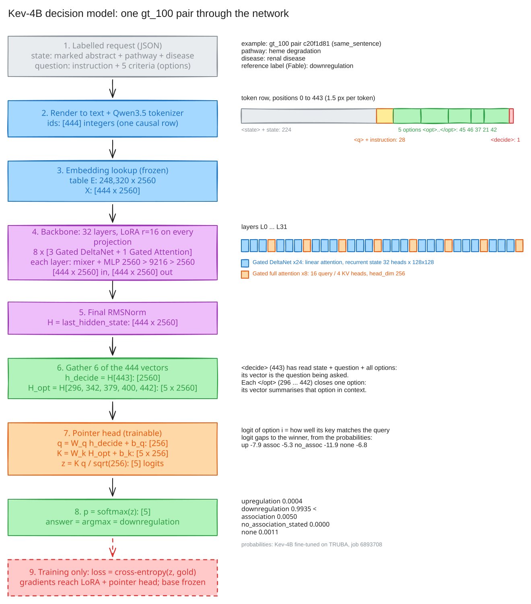

# Kev bir relation'a nasıl karar verir: bir gt_100 çiftinin ağdaki yolu

Kev, pathway–disease relation sınıflandırması için fine-tune ettiğimiz decision
model'dir. Metin üretmez. Abstract'ı ve soruyu tek bir token dizisi olarak
okur, ardından cevap seçeneklerinden birini *işaret eder*.

Bu dosya, gerçek bir ground truth çiftini her adımda takip eder. Her adım için
şunları verir:

- ne yapıldığı;
- aktarılan her tensörün boyutu ve ne anlama geldiği;
- kodun nerede olduğu.

İngilizce sürüm: [kev_architecture.md](kev_architecture.md).



Figürün düzenlenebilir kaynağı:
[kev_architecture.excalidraw](kev_architecture.excalidraw) (excalidraw.com'da
açılır).

Örnek çift, relation test setinden **"heme degradation" – "renal disease"**
(gt_100 adayı `c20f1d81558adc64`, stratum `same_sentence`):

- abstract'ta 1 pathway mention'ı ve 1 disease mention'ı var, ikisi aynı
  cümlede;
- referans etiketi (Fable teacher) `downregulation`;
- abstract, heme degradation'ı yürüten heme oxygenase aktivitesinin
  *artırılmasının* böbrek hastalığında koruyucu olduğunu söylüyor.
  Müdahalelere ilişkin etiketleme kuralına göre "pathway'i aktive etmek işe
  yarıyor" ifadesi `downregulation` demektir.

Tekrar eden sayılar:

| Sayı | Anlamı |
|---|---|
| 444 | Bu örneğin token satırının uzunluğu: state + soru + 5 seçenek + `<decide>`. |
| 2560 | Qwen3.5-4B'nin hidden boyutu: her token 2560 sayılık bir vektöre dönüşür. |
| 248.320 | Sözlük boyutu, yani embedding tablosunun satır sayısı. |
| 32 | Decoder katmanı: 24 Gated DeltaNet + 8 Gated full attention. |
| 9216 | Her MLP'nin iç genişliği. |
| 256 | Pointer head'in eşleştirme uzayının genişliği (`--head_dim`). |
| 16 | Her projeksiyondaki LoRA rank'i. |
| 5 | Relation etiketleri: upregulation, downregulation, association, no_association_stated, none. |
| `[a x b]` | b sayıdan oluşan a satır. Her seferinde tek kayıt işlendiği için batch ekseni yok. |

---

## Sayıların kaynağı

- **Katman boyutları:** `Qwen/Qwen3.5-4B-Base@1001bb4d`'nin `config.json`'ı
  ve safetensors header'ları. Kesin.
- **Model kodu:** Kev, commit `2074cc44` (`kev/model.py`, `kev/api.py`,
  `kev/data.py`, `kev/train.py`). Kesin.
- **Token sayıları ve pozisyonlar:** aynı revizyondaki modelin kendi
  tokenizer'ı, `build_kev_data.py --gt100`'ün yazdığı kayda Kev'in kodlama
  kurallarıyla uygulandı.
  - Lokalde `tokenizers` 0.22.2 ile hesaplandı; Kev ise transformers
    üzerinden 0.23.2 kullanıyor.
  - İkisi de aynı `tokenizer.json`'ı okuduğu için sayıların tutması gerekir,
    ama Kev'in içinde kontrol edilmedi.
- **Olasılıklar:** TRUBA run'ı `kev-4b_silver_6893708`'in
  `gt_100_predictions.json`'ı (Kev-4B, eski `silver_2k_full` split'inde 1
  epoch).
  - Yalnızca örnek amaçlı: eski veriyle yapılmış tek bir run; alıntılanacak
    bir sonuç değil.
- **Ara vektörlerin değerleri:** ölçülmedi; yalnızca boyutları veriliyor.

---

## 1 · Etiketli istek

**Adımlar**

- `build_kev_data.py` her çift için bir JSON kaydı yazar:
  - `state`: çiftin her mention'ı `[[PATHWAY]] … [[/PATHWAY]]` ve
    `[[DISEASE]] … [[/DISEASE]]` ile sarılmış abstract, ayrıca pathway ve
    disease adları;
  - bir `choice` sorusu: instruction ve her etiket için bir tane olmak üzere
    beş kriter;
  - etiket.
- Kev'in `api.to_record`'u bunu düz metne çevirir:
  - state, alan adları etiket olarak korunarak düzleştirilir:
    `abstract: …`, `pathway: heme degradation`, `disease: renal disease`;
  - her kriter bir seçenek metni olur: `"<ad>: <açıklama>"`;
  - etiket, indeksiyle değiştirilir (1, `downregulation`).

**Sayılar**

- 1 state, 1 soru, 5 seçenek.

**Implementasyon**

- `relation_extraction/decision_models/build_kev_data.py`: `request()`,
  `gt100_requests()`, `CRITERIA`, `INSTRUCTIONS`.
- Kev: `kev/api.py` `render()`, `option_text()`, `to_record()`.

## 2 · Token'lar: 444 id'lik tek satır

**Adımlar**

- `kev.model.encode` kaydı tek bir token satırına paketler:
  - `<state>` + state metni;
  - `<q>` + instruction;
  - her seçenek için: `<opt>` + seçenek metni + `</opt>`;
  - en sonda `<decide>`.
- Beş ayraç, Qwen'in nadiren kullanılan token'larını yeniden kullanır; bu
  yüzden embedding'e satır eklenmez:
  - `<state>` = `<|fim_prefix|>`, id 248060;
  - `<q>` = `<|fim_middle|>`, id 248061;
  - `<opt>` = `<|box_start|>`, id 248049;
  - `</opt>` = `<|box_end|>`, id 248050;
  - `<decide>` = `<|fim_suffix|>`, id 248062.
- Kullanıcının verdiği metin hiçbir zaman ayraç üretemez: içindeki her
  `<|ad|>`, tokenize edilmeden önce `<¦ad¦>`'ye çevrilir.
- **Soru başına bir satır.** Qwen3.5 hibrit bir model.
  - Recurrent DeltaNet katmanları, birkaç sorunun tek bir paketlenmiş diziyi
    paylaşmasını sağlayacak blok maskesini uygulayamaz.
  - Bu yüzden her soru kendi causal satırında koşar: state, ardından o
    sorunun dalı.
  - Çift başına tek soru sorduğumuz için tek satır var.

**Sayılar**

`ids [444]`, token başına bir id:

| Bölüm | Token | Pozisyon |
|---|---|---|
| `<state>` + state | 1 + 223 = 224 | 0–223 |
| `<q>` + instruction | 1 + 27 = 28 | 224–251 |
| seçenek 1 `upregulation: …` | `<opt>` + 43 + `</opt>` = 45 | 252–296 |
| seçenek 2 `downregulation: …` | 46 | 297–342 |
| seçenek 3 `association: …` | 37 | 343–379 |
| seçenek 4 `no_association_stated: …` | 21 | 380–400 |
| seçenek 5 `none: …` | 42 | 401–442 |
| `<decide>` | 1 | 443 |

- Run'larımızdaki state sınırı: 2.200 token (`--max_state 2200`).
  - gt_100'de state'in medyanı 392, maksimumu 790 token; hiçbir abstract
    kesilmiyor.

**Implementasyon**

- Kev: `kev/model.py` `encode()`, `user_tokens()`, `SPECIAL`, `rows_of()`.

## 3 · Embedding

**Adımlar**

- Her id, embedding tablosunun bir satırını seçer.
- Tablo dondurulmuştur; LoRA ona dokunmaz.
- Bu adımdan sonra bir vektör yalnızca *hangi token* olduğunu söyler. Bağlamı
  katmanlar ekler.

**Sayılar**

- `E [248.320 x 2560]`: her sözlük girdisi için 2560 sayılık bir satır.
- Lookup sonucu `X [444 x 2560]`.

## 4 · Backbone: 32 katman

**Adımlar**

- Katmanlar sabit bir 3 : 1 düzenini izler: 3, 7, 11, …, 31. katmanlar full
  attention, diğer 24 katman Gated DeltaNet kullanır.
- Her katmanın dış yapısı aynıdır:

  ```
  x = x + Mixer(RMSNorm(x))     # mixes information across tokens
  x = x + MLP(RMSNorm(x))       # transforms each token on its own
  ```

- Her token yalnızca kendinden önceki token'ları okuyabilir (causal).
  - `<decide>`'daki vektör, abstract'ı, soruyu ve beş seçeneğin hepsini bu
    sayede "bilir".
- **Gated DeltaNet mixer'ı** (24 katman), token başına:
  - token, her head için bir query, bir key ve bir value'ya projekte edilir;
  - kısa bir depthwise konvolüsyon her kanalı son 4 token üzerinden karıştırır;
  - her value head'i çalışan bir bellek matrisi `S` tutar. Her token için:
    - bellek, öğrenilmiş head'e özgü bir faktörle sönümlenir;
    - mevcut key altında saklanan değer kısmen silinir;
    - yeni değer, öğrenilmiş bir yazma gücü β ile yazılır ("delta kuralı");
    - token'ın çıktısı, query'si ile bellekten okunan değerdir;
  - gated bir RMSNorm ve bir çıkış projeksiyonu 2560 sayıya geri döndürür;
  - maliyet uzunlukla doğrusal artar; uzun abstract'ları ucuz tutan budur.
- **Gated full attention** (8 katman):
  - her token, önceki her token'a birebir dikkat eder; maliyet uzunluğun
    karesiyle artar;
  - aynı token'dan hesaplanan bir çıkış kapısı sonucu ölçekler;
  - bu katmanlar kesin, uzun menzilli bakışları taşır; örneğin `<decide>`'dan
    işaretli `[[DISEASE]]` span'ine geri bakmak.
- **MLP** (her katmanda): iki paralel genişletme, gated bir aktivasyon ve geri
  projeksiyon.
- **LoRA:**
  - base ağırlıklar dondurulmuş kalır;
  - fine-tuning her projeksiyona rank-16 bir güncelleme `B·A` ekler (α = 32
    ile ölçeklenir): attention projeksiyonları, DeltaNet projeksiyonları ve
    MLP;
  - pointer head ile birlikte 33,8M eğitilebilir parametre eder; dondurulmuş
    parametre sayısı yaklaşık 4B.

**Sayılar**

- Her katmanın girdisi ve çıktısı: `[444 x 2560]`. Boyut hiç değişmez;
  değişen içeriktir.
- Gated DeltaNet, checkpoint'ten:
  - `in_proj_qkv [8192 x 2560]`: token başına query 16 × 128, key 16 × 128,
    value 32 × 128.
  - `conv1d [8192 x 1 x 4]`: depthwise, kernel 4.
  - `in_proj_z [4096 x 2560]`: çıkış kapısı, 32 head × 128.
  - `in_proj_a [32 x 2560]`: value head'i başına sönüm. `in_proj_b
    [32 x 2560]`: value head'i başına yazma gücü β.
  - bellek `S`: 32 value head'i × `[128 x 128]`. İki value head'i bir key
    head'ini paylaşır (16 key head'i).
  - `out_proj [2560 x 4096]`.
- Gated full attention:
  - `q_proj [8192 x 2560]`: 16 query head'i × 256, artı aynı boyutta bir çıkış
    kapısı.
  - `k_proj`, `v_proj [1024 x 2560]`: 4 key/value head'i × 256; her biri 4
    query head'i tarafından paylaşılır.
  - katman başına attention ağırlıkları: `[16 x 444 x 444]`, yalnızca alt
    üçgen.
  - `o_proj [2560 x 4096]`.
- MLP: `gate_proj`, `up_proj [9216 x 2560]`; `down_proj [2560 x 9216]`.
- `[out x in]` boyutundaki bir projeksiyonda LoRA: `A [16 x in]`,
  `B [out x 16]`.

**Implementasyon**

- Kev: `kev/model.py` `DecisionModel.__init__()` (LoRA hedefleri; hibrit
  backbone'larda `in_proj_qkv`, `in_proj_z`, `in_proj_a`, `in_proj_b`,
  `out_proj` dahil) ve `_rows_hidden()`.
- Katmanların kendisi transformers'ın Qwen3.5 implementasyonu.

## 5 · Son norm

**Adımlar**

- 31. katmandan sonra bir RMSNorm `last_hidden_state`'i verir.
- Kev, backbone'u sözlük head'i olmadan yükler
  (`AutoModelForCausalLM(...).model`), çünkü hiçbir zaman sonraki token'ı
  tahmin etmez.

**Sayılar**

- `H [444 x 2560]`: token başına bağlamı içeren bir vektör.

## 6 · 444 vektörden 6'sını seç

**Adımlar**

- Yalnızca altı pozisyon okunur; kalan 438 vektör atılır.
- **`<decide>` (pozisyon 443):**
  - en sonda geldiği için abstract'ı, soruyu ve her seçeneği görmüştür;
  - vektörü, modelin *bu çift hakkında ne sorulduğunun* özetidir.
- **Beş `</opt>` token'ı (pozisyon 296, 342, 379, 400, 442):**
  - her biri bir seçeneği kapatır;
  - vektörü *o seçeneği, bu abstract bağlamında okunmuş haliyle* özetler;
  - 1. seçeneğin `</opt>`'u 2–5. seçenekleri görmemiştir. Seçenek sırasının
    önemli olmasının ve eğitimde sıranın karıştırılmasının bir nedeni budur.

**Sayılar**

- `h_decide = H[443]`: `[2560]`.
- `H_opt = H[[296, 342, 379, 400, 442]]`: `[5 x 2560]`.

**Implementasyon**

- Kev: `kev/model.py` `encode()` `decide_idx` ve `opt_idx`'i kurar;
  `_readout()` onları toplar.

## 7 · Pointer head

**Adımlar**

- `<decide>` vektörü 256 boyutlu bir eşleştirme uzayına projekte edilir:
  **query**.
- Her `</opt>` vektörü aynı uzaya projekte edilir: seçenek başına bir **key**.
- Her seçeneğin logit'i, key'inin query ile ölçeklenmiş dot product'ıdır: o
  seçeneğin soruya ne kadar iyi cevap verdiği.
- Bu, pointer olarak kullanılan tek query'li bir attention'dır.
  - Seçenekler sabit bir çıkış katmanıyla değil eşleştirmeyle skorlandığı
    için aynı head, her seçenek sayısı ve her etiket adıyla çalışır.
- Head, Kev release'inden yüklenir ve LoRA ağırlıklarıyla birlikte fine-tune
  edilir.

**Sayılar**

- `W_q`, `W_k [256 x 2560]`, her biri 256'lık bir bias ile.
- `q = W_q · h_decide + b_q`: `[256]`.
- `K = W_k · H_opt + b_k`: `[5 x 256]`.
- `z = K · q / sqrt(256)`: `[5]` logit.
- 8. adımdaki olasılıklar, logit'leri ortak bir sabit dışında geri verir:
  `z_i − z_max = ln p_i − ln p_max`. `downregulation`'a göre:
  - upregulation −7,9;
  - association −5,3;
  - none −6,8;
  - no_association_stated −11,9.

**Implementasyon**

- Kev: `kev/model.py` `PointerHead.forward()`; ağırlıkları her checkpoint'te
  `head.pt` olarak kaydedilir.

## 8 · Softmax ve cevap

**Adımlar**

- Softmax beş logit'i olasılığa çevirir; en büyüğü cevaptır.
- Bir checkpoint kalibrasyon sıcaklığı taşıyabilir. Inference'ta logit'ler bu
  değere bölünür; bu, güveni değiştirir ama argmax'ı hiçbir zaman
  değiştirmez.
- `eval_kev.py` beş olasılığın hepsini saklar ve argmax'ı `pred` olarak
  raporlar.

**Sayılar**

- `p [5]`:
  - upregulation 0,0004;
  - **downregulation 0,9935**, cevap ve doğru;
  - association 0,0050;
  - no_association_stated 0,00001;
  - none 0,0011.

**Implementasyon**

- `relation_extraction/decision_models/eval_kev.py`: skorlama, etiket başına
  F1, stratum bazında raporlar.

## 9 · Eğitim (inference'ın parçası değil)

**Adımlar**

- Loss: `z` ile gold indeksi arasında cross-entropy.
- Gradient'ler yalnızca LoRA matrislerini ve pointer head'i günceller.
- `kev.train` her epoch'ta her kaydın yeni bir varyantını kurar:
  - seçenek sırası karıştırılır;
  - küçük olasılıklarla bir "hiçbiri" seçeneği ya da bir dikkat dağıtıcı
    seçenek eklenir (run'larımızda `p_none 0.1`, `p_none_distract 0.12`,
    `p_distract 0.15`);
  - böylece model seçeneklerin *anlamı* yerine *pozisyonunu* öğrenmez.
- Learning rate: tüm run boyunca tek bir OneCycle schedule (%10 warm-up,
  ardından azalma).
  - 3 epoch'luk bir run'ın 1 epoch'luk bir modele bölünememesinin ve
    sweep'imizin her epoch sayısını ayrı bir job olarak eğitmesinin nedeni
    budur.

**Sayılar**

- 2.225 eğitim çifti ÷ (batch 1 × accumulation 8) ≈ epoch başına 279 optimizer
  step'i.
- lr 2e-5, bf16 ağırlık ve hesaplama, gradient checkpointing.
- Tek bir A100 80GB'da (UHEM Altay) ölçülen: optimizer step'i başına yaklaşık
  7,2 s, inference'ta çift başına 0,12 s.

**Implementasyon**

- `relation_extraction/decision_models/train_kev.sh`: `kev.train`'i çağırır,
  ardından dev dilimini skorlar.
- `slurm/kev_altay.slurm`: UHEM Altay'da bir (epoch, seed) hücresi; veriyi
  kurar, eğitir, dev'i ve gt_100'ü skorlar.
- Kev: `kev/train.py` (`OneCycleLR`, `record_variants()`), `kev/data.py`
  (`augment`).

---

## Checkpoint'ler

| Yol | İçerik |
|---|---|
| `/home/enes/artifacts/checkpoints/relation_decision_models/kev-4b_ft_silver_e1/kev-4b_silver_6893708/` | Kev-4B, 1 epoch, eski `silver_2k_full` split'i (TRUBA). **Yukarıdaki olasılıkların kaynağı.** |
| `/home/enes/artifacts/checkpoints/relation_decision_models/kev-0.8b_ft_silver_s0/` | Kev-0.8B pilotu (lokal RTX 4060). |
| `/ari/users/abedir/kev/runs/kev-4b_10kpm_e{1,3}_s{0,1,2}_<jobid>/` | `silver_2k_10kplusmissing` üzerindeki güncel sweep (UHEM Altay). UHEM diskleri yedeklenmiyor; run'lar bitince dışarı kopyalanmalı. |

Her checkpoint dizininde `adapter_model.safetensors` (LoRA), `head.pt`
(pointer head), tokenizer dosyaları, `training_config.json` ve
`training_metrics.json` bulunur. Dondurulmuş backbone saklanmaz; yüklemek için
`Qwen/Qwen3.5-4B-Base@1001bb4d` gerekir. Adapter ve head,
`jaredpalmer/kev-4b@6cfce5c2` release'inden başlatıldı ve onun üzerine
öğrenilenleri zaten içeriyor.
